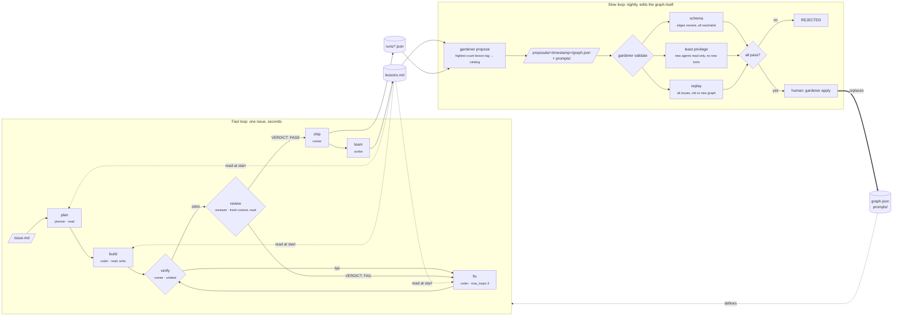

# todo-graph-demo

A graph of seven agents maintains a small to-do API, and a slower loop grows the graph itself: it reads what went wrong, proposes a new agent, and a script decides whether that agent is allowed in. A human applies the result. In the shipped runs, the proposed agent cut fix loops from 2 to 0 across three issues.

The pattern follows Boris Cherny's claim that loops, not prompts, drive agents ([TechCrunch, 2026-06-22](https://techcrunch.com/2026/06/22/the-ai-world-is-getting-loopy)). Here the unit of control is `graph.json`, 30 lines of data, and 4 of the 7 nodes are agents. The other 3 are plain code, because tests and permission checks are not things a model gets a vote on.

## Get started

You need Python 3.9 or newer. There are no other dependencies. Fake mode runs the whole loop with scripted stand-ins for the agents, so it costs no tokens and gives the same result every time.

**1. Clone and run the three issues through the graph** (about 2 seconds)

```bash
git clone git@github.com:ivikash/todo-graph-demo.git && cd todo-graph-demo
cp -r app /tmp/app-scratch
for i in issues/*.md; do python3 run.py "$i" --fake --app /tmp/app-scratch; done
```

Each run prints one line per node. Issue 001 ends with `run: loops=1 failures=1 tests_green=True`: the coder skipped an error path, the tests caught it, the fix loop closed it. Issue 002 ends with `loops=0`. Issue 003 passes the tests but the reviewer prints `VERDICT: FAIL acceptance line 'still returns copies' is untested`, and the fix loop adds the missing test. The copy under `/tmp/app-scratch` keeps the committed `app/` at its starting state.

**2. Read what the graph learned**

```bash
cat lessons.md
```

Two rows, one per fix loop, each with a date, a one-word tag, what went wrong and the rule that prevents it. The `learn` node wrote them. The `plan`, `build` and `fix` nodes read them at the start of every later run.

**3. Let the gardener propose a change to the graph**

```bash
python3 gardener.py propose
```

It counts the lesson tags, picks the tag with the highest count, and writes `proposals/<timestamp>/` with a new `graph.json`, a new prompt and a `report.md`. For the shipped lessons it proposes a read-only agent `spec-checker` and a node `spec-check` between `plan` and `build`. It does not change the live graph.

**4. Validate the proposal**

```bash
python3 gardener.py validate proposals/<timestamp>
```

Three checks print as a table. Schema: every edge resolves and every node is reachable. Least privilege: no existing agent gained a tool and no new agent has `write`. Replay: all three issues run through the old graph and the new one, and the new one has to be no worse. The shipped proposal prints `baseline loops=2 failures=2; proposal loops=0 failures=0` and `VALIDATED: safe to apply (human step)`. The folder gets a `VALIDATED` marker, or `REJECTED`.

**5. Apply it, if you agree**

```bash
python3 gardener.py apply proposals/<timestamp>
```

This is the one step the scripts leave to a person. It copies the proposed `graph.json` and prompt into place and keeps the previous graph beside the proposal as `graph.before.json`. Run step 1 again and issue 001 and 003 pass on the first try.

**To see the gate refuse something**, validate the hand-made counterexample. It asks for `write` and `deploy` tools and wires `review` out of the graph:

```bash
python3 gardener.py validate proposals/bad-example
```

All three checks fail and the folder is marked `REJECTED`.

**Real agents.** Run `kiro-cli login`, then drop `--fake`. Each node becomes one `kiro-cli chat --no-interactive` process. Agents whose tool list contains `write` get `--trust-all-tools`. The planner, reviewer and scribe run read-only. If an agent cannot run (not logged in, non-zero exit) the run stops with `agent_error` instead of looping.

**Your own harness.** `run.py` stands in for a harness. [`ports/`](ports/README.md) wires the same graph into Claude Code, Codex and Kiro Crew with their native primitives (instructions file, agent definitions, skills, hooks, headless run), and shares the two skills and the gate scripts:

```bash
bash ports/install.sh claude-code    # or: codex | kiro-crew
```

## How it works



The same picture as text, for terminals:

```
 FAST LOOP (per issue)                      SLOW LOOP (nightly / on demand)
 ───────────────────────────────            ─────────────────────────────────────
 plan ─► build ─► verify ─fail─► fix ─┐     gardener propose
                    │pass        ▲    │        reads runs/*.json + lessons.md
                    ▼            └────┘        picks the lesson tag with the highest count
                 review ──fail────┘            turns it into a change to graph.json:
                    │pass                        - a prompt rule        (prose)
                    ▼                            - a NEW agent + node   (structure)
                  ship ─► learn ─► lessons.md        ▼
                                             gardener validate
                                                schema · least privilege · replay all issues
                                                proposal must be no worse than baseline
                                                     ▼
                                             VALIDATED  ─►  human runs `apply`  ─►  graph.json changes
```

Four loops run at four speeds. Each one edits a different thing, and a different mechanism closes it.

| Loop | Speed | Edits | Who closes it |
|---|---|---|---|
| verify / fix | seconds | the product (`app/`) | the tests |
| review / fix | seconds | the product | a reviewer that never saw the build |
| learn | once per run | `lessons.md` (prose) | the scribe |
| gardener | nightly | the graph itself (`graph.json`, `prompts/`) | the validator, then a human |

A node is one entry in `graph.json`: `{agent, next | pass | fail, max_loops}`. Every agent node runs as a fresh process, so the reviewer judges the diff with no memory of how the coder produced it. The runner node runs `python3 -m unittest` and follows the exit code. The prompt for a node lives in `prompts/<node>.md` and describes the node. The graph decides what happens next.

## What the shipped runs show

Three fake runs produced two fix loops and two lessons.

| Issue | What happened | Caught by | Lesson tag |
|---|---|---|---|
| 001 complete | the coder skipped the "raises KeyError" acceptance line | verify (tests) | `missing-error-path` |
| 002 delete | clean | | |
| 003 list filter | the code was right, one acceptance line had no test | review (fresh-context reviewer) | `untested-acceptance-line` |

The gardener read those runs and proposed the `spec-checker` agent and `spec-check` node. Replay against the old and the new graph: baseline 2 loops and 2 failures, proposal 0 and 0. The proposal passed schema and least privilege and sits in `proposals/20261121T190203/` as VALIDATED, waiting for `apply`.

## Files

| Path | What it is |
|---|---|
| `graph.json` | the graph: agents with their tool sets, nodes, edges (`next`, `pass`, `fail`), `max_loops` |
| `prompts/<node>.md` | one prompt per node. The runner fills `{{issue}}`, `{{plan}}`, `{{lessons}}`, `{{failure}}` and `{{diff}}` |
| `app/todo.py`, `app/test_todo.py` | the product the graph maintains. It starts with `add` and `list` only |
| `issues/*.md` | three work items, each with acceptance lines |
| `run.py` | walks the graph for one issue. Every agent node is a fresh `kiro-cli chat --no-interactive` process |
| `lessons.md` | what the runs taught. Read by plan, build and fix, mined by the gardener |
| `runs/*.json` | one record per run: nodes visited, loops, failures, verdicts, timings |
| `gardener.py` | `propose`, `validate`, `apply` |
| `proposals/<timestamp>/` | a proposed graph, its prompts, `report.md`, and a `VALIDATED` or `REJECTED` marker |
| `fake_world.py` | scripted stand-ins for the agent nodes, so the mechanics run for free |
| `ports/` | the same graph for Claude Code, Codex and Kiro Crew, written as skills, agent files and hooks |

## The three ideas

1. **Graph over prompt.** A `fail` edge that routes test output back to a fixer does what a paragraph saying "please verify" cannot: it cannot be skipped. The prompt describes a node. The graph decides what happens next.
2. **Lesson to structure.** Prose lessons drift. When a lesson tag repeats, the gardener turns it into a node. That is what recurring self-improvement means in practice: the slow loop edits the fast loop.
3. **Agents build agents, behind a gate.** The gardener adds a worker only when it is read-only, only with tools an existing agent already has, only when replay is no worse, and only as a draft a human applies. The gate is the safety story.

## Where this is a toy

- `fake_world.py` scripts the coder's mistakes, and a real coder's mistakes are not this tidy. The replay check proves the mechanism, not the real-world effect size.
- The catalog in `gardener.py` maps a tag to a change by hand. The next step is an agent that writes the proposal, with `validate` kept exactly as strict.
- Replay runs in fake mode. With live agents, replay would re-run held-out issues and compare loop counts, which costs tokens.
- Lessons are one flat table. At scale you want the join between lessons and runs, so the gardener can retire a lesson once its node exists.

## Map to a real harness

| Here | In a real setup (Kiro Crew, Claude Code, [vstack](https://github.com/ivikash/vstack)) |
|---|---|
| `graph.json` | a workflow definition as data (vstack `workflows/*.json`) |
| review node and VERDICT | a critic that refuses the draft (vstack `draft_contract`, a style gate) |
| `lessons.md` | the harness's lessons file plus a per-workflow `mistakes.md` |
| gardener propose | a skill that turns a session into a reusable skill, an eval runner |
| validate: least privilege | the harness's agent-definition validator |
| fresh-context reviewer | a subagent spawned without the parent's memory |
| human `apply` | a draft commit the owner merges |

## Sources

- Boris Cherny at Meta @Scale on loops, as reported by [TechCrunch, 2026-06-22](https://techcrunch.com/2026/06/22/the-ai-world-is-getting-loopy)
- A summary of his graph-engineering remarks on [promptgenius.net](https://promptgenius.net/blog/graph-engineering-agents)
- His CLAUDE.md self-improvement loop, in [this gist](https://gist.github.com/hqman/e29cb6386c539d795767e8c3fd2c959b)
