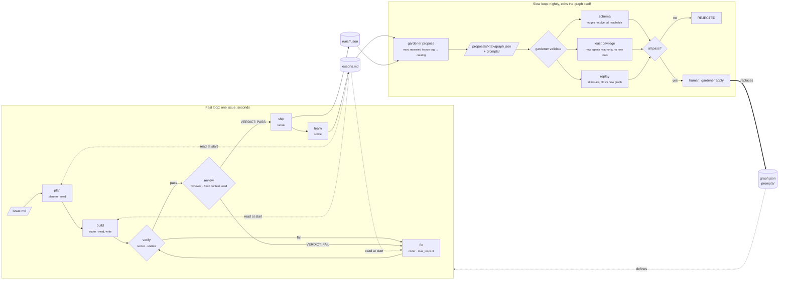

# todo-graph-demo: a graph of agents that maintains a to-do API and improves itself

A teaching-size version of the pattern Boris Cherny describes as "I don't prompt agents, loops prompt them": the unit of control is a **graph** (data in `graph.json`), not a prose prompt. Three loops run at different speeds, and the slowest one is allowed to add new agents to the graph, behind a validator and a human.

## Architecture



Same picture as text, for terminals:

```
 FAST LOOP (per issue)                      SLOW LOOP (nightly / on demand)
 ───────────────────────────────            ─────────────────────────────────────
 plan ─► build ─► verify ─fail─► fix ─┐     gardener propose
                    │pass        ▲    │        reads runs/*.json + lessons.md
                    ▼            └────┘        picks the most repeated lesson tag
                 review ──fail────┘            turns it into a change to graph.json:
                    │pass                        - a prompt rule        (prose)
                    ▼                            - a NEW agent + node   (structure)
                  ship ─► learn ─► lessons.md        ▼
                                             gardener validate
                                                schema · least privilege · replay all issues
                                                proposal must be no worse than baseline
                                                     ▼
                                             VALIDATED  ─►  human runs `apply`  ─►  graph.json changes
```

| Loop | Speed | Edits | Who closes it |
|---|---|---|---|
| verify/fix | seconds | the product (`app/`) | tests |
| review/fix | seconds | the product | a reviewer with no memory of the build |
| learn | per run | `lessons.md` (prose) | the scribe |
| gardener | nightly | the graph itself (`graph.json`, `prompts/`) | validation, then a human |

## Files

| Path | What |
|---|---|
| `graph.json` | the graph: agents (tool sets), nodes, edges (`next` / `pass` / `fail`), `max_loops` |
| `prompts/<node>.md` | one prompt per node; `{{issue}}`, `{{plan}}`, `{{lessons}}`, `{{failure}}`, `{{diff}}` are filled by the runner |
| `app/todo.py`, `app/test_todo.py` | the product the graph maintains (starts with add/list only) |
| `issues/*.md` | work items, each with acceptance lines |
| `run.py` | walks the graph for one issue; every LLM node is a fresh `kiro-cli chat --no-interactive` process |
| `lessons.md` | what the runs taught; read by plan/build/fix, mined by the gardener |
| `runs/*.json` | one record per run: nodes visited, loops, failures, verdicts, timings |
| `gardener.py` | `propose`, `validate`, `apply` |
| `proposals/<ts>/` | a proposed graph + prompts + `report.md` + `VALIDATED` or `REJECTED` marker |
| `fake_world.py` | deterministic stand-ins for the LLM nodes so the mechanics can be watched for free |

## Run it

Fake mode (no tokens, deterministic, what the shipped `runs/` and `lessons.md` came from):

```bash
git clone git@github.com:ivikash/todo-graph-demo.git && cd todo-graph-demo
cp -r app /tmp/app-scratch                       # keep the committed app at its starting state
for i in issues/*.md; do python3 run.py "$i" --fake --app /tmp/app-scratch; done
cat lessons.md
python3 gardener.py propose                      # writes proposals/<ts>/
python3 gardener.py validate proposals/<ts>      # schema, least privilege, replay
python3 gardener.py apply    proposals/<ts>      # the human step
```

Real mode (live agents): `kiro-cli login` first, then drop `--fake`. Each node is one `kiro-cli chat --no-interactive` call. Only agents whose tool list contains `write` get `--trust-all-tools`; the planner, reviewer and scribe run read-only. If an agent cannot run (not logged in, non-zero exit) the run aborts with `agent_error` instead of looping.

## What the shipped state shows

Three fake runs produced two fix loops and two lessons:

| Issue | What happened | Caught by | Lesson tag |
|---|---|---|---|
| 001 complete | coder skipped the "raises KeyError" line | verify (tests) | `missing-error-path` |
| 002 delete | clean | | |
| 003 list filter | implementation right, one acceptance line untested | review (fresh-context reviewer) | `untested-acceptance-line` |

The gardener read those and proposed a **new agent** `spec-checker` (read-only) and a **new node** `spec-check` between `plan` and `build`. Validation replayed all three issues against the old and the new graph: baseline 2 loops / 2 failures, proposal 0 / 0. It passed schema and least privilege and is sitting in `proposals/` as VALIDATED, waiting for `apply`.

`proposals/bad-example/` is a hand-made counterexample: an `auto-merger` agent asking for `write` and `deploy`, wired so `review` is unreachable. Validation rejects it on all three checks.

## The three ideas, in one line each

1. **Graph over prompt.** A `fail` edge that routes test output back to a fixer is worth more than a paragraph saying "please verify". The prompt describes a node; the graph decides what happens next.
2. **Lesson to structure.** Prose lessons drift. When a lesson tag repeats, the gardener turns it into a node nobody can skip. That is what "recurring self-improvement" means in practice: the slow loop edits the fast loop.
3. **Agents build agents, behind a gate.** The gardener may add a worker, but only a read-only one, only with tools somebody already has, only if replay is no worse, and only as a draft a human applies. The gate is the whole safety story.

## Where this is a toy

- `fake_world.py` scripts the coder's mistakes; a real coder's mistakes are not this tidy. The replay check is honest about the mechanism, not about real-world effect size.
- The catalog in `gardener.py` maps a tag to a change by hand. The next step is to let an LLM node write the proposal and keep `validate` exactly as strict.
- Replay uses fake mode. For real agents, replay would re-run held-out issues with live agents and compare loop counts, which costs tokens.
- Lessons are one flat table. At scale you want the tag counts and the "which lesson fired on which run" join that lets the gardener retire a lesson once its node exists.

## Map to a real harness

| Here | In a real setup (Kiro Crew / Claude Code / [vstack](https://github.com/ivikash/vstack)) |
|---|---|
| `graph.json` | a workflow definition as data (vstack `workflows/*.json`) |
| review node / VERDICT | a critic that refuses the draft (vstack `draft_contract`, a style gate) |
| `lessons.md` | the harness's lessons file plus a per-workflow `mistakes.md` |
| gardener propose | a skill that turns a session into a reusable skill, an eval runner |
| validate: least privilege | the harness's agent-definition validator |
| fresh-context reviewer | a subagent spawned without the parent's memory |
| human `apply` | a draft commit the owner merges |

## Sources

- Boris Cherny at Meta @Scale on loops, as reported by [TechCrunch, 2026-06-22](https://techcrunch.com/2026/06/22/the-ai-world-is-getting-loopy)
- A summary of his graph-engineering remarks: [promptgenius.net](https://promptgenius.net/blog/graph-engineering-agents)
- His CLAUDE.md self-improvement loop: [gist](https://gist.github.com/hqman/e29cb6386c539d795767e8c3fd2c959b)
